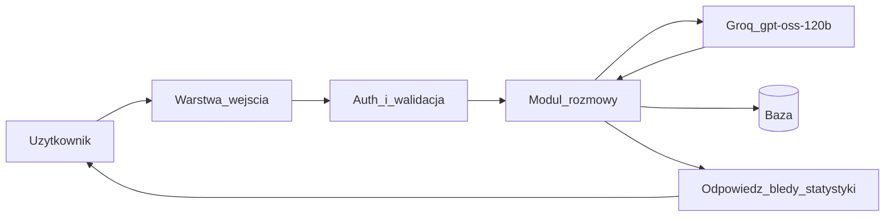

# Plan aplikacji do nauki języków z AI

Źródłem wymagań jest dokumentacja inżynierii wymagań (LanguageMate Sp. z o.o., zamawiający: Paweł Lewandowski). Zespół: Łukasz Skrzypek, Maciej Antosz, Arek Kępa.

Aplikacja prowadzi z użytkownikiem pisemną rozmowę w języku obcym, dostosowaną do wybranego poziomu, poprawia błędy i zapisuje postępy na koncie.

## Cel i zakres

Aplikacja desktop/WEB: ta sama aplikacja webowa otwierana w przeglądarce, bez wersji mobilnej i bez natywnego klienta. Użytkownik loguje się, wybiera język (PL / EN / ES) i poziom, prowadzi pisemny czat z modelem językowym, a po rozmowie dostaje listę błędów z korektami oraz statystyki na koncie.

Poza zakresem, zgodnie z dokumentem:

- automatyczne wykrywanie poziomu po rozmowie wstępnej,
- rozmowa głosowa,
- aplikacja mobilna.

### Założenia uzupełniające dokument

- Rejestracja konta (e-mail i hasło). Mock interfejsu pokazuje tylko logowanie, a model danych zakłada konta użytkowników.
- Poziomy CEFR: A1, A2, B1, B2, C1, C2. Dokument mówi, że poziom wybiera użytkownik, ale nie podaje skali.
- Jedna aplikacja webowa obsługuje zarówno WEB, jak i desktop. Takie podejście wynika z uzasadnienia Pythona w dokumencie: framework webowy wystawia tę samą logikę dla obu wersji.
- Jedyny dostawca LLM: Groq, model `openai/gpt-oss-120b`. Adres bazowy `https://api.groq.com/openai/v1` (API zgodne z OpenAI). Model i adres są stałymi konfiguracji projektu, nie wyborem użytkownika.
- Klucz API jest czytany przy starcie z pliku tekstowego `groq_api_key.txt` w katalogu głównym (pierwsza niepusta linia, bez cudzysłowów). Plik jest w `.gitignore` i nie wchodzi do commita. W repozytorium zostaje tylko `groq_api_key.txt.example` z instrukcją, bez prawdziwego klucza. Brak pliku lub pusty plik kończy start czytelnym błędem, zamiast wołać Groq bez autoryzacji.

## Aktorzy i przypadki użycia

Aktorzy: użytkownik (osoba ucząca się języka) oraz zewnętrzne API Groq.

Przypadki wynikające z dokumentu i mocków:

- Rejestracja i logowanie. Adres e-mail jest unikalny, hasło jest przechowywane wyłącznie jako skrót.
- Przypomnienie hasła.
- Wybór języka i poziomu oraz rozpoczęcie rozmowy.
- Wymiana wiadomości w czacie: tekst użytkownika, odpowiedź AI, wykrycie błędów.
- Podgląd listy błędów po zakończeniu rozmowy.
- Podgląd statystyk i ich reset dla wybranego języka.

Wyzwalacz: zalogowany użytkownik wybiera język i poziom, a następnie rozpoczyna rozmowę. W trakcie rozmowy system zwraca odpowiedź rozmówcy AI. Po rozmowie zwraca listę błędów z korektami oraz statystyki.

## Model danych

Tabele zgodne z punktem 3 dokumentu.

**Użytkownicy**

- `id` (int, unique)
- `email` (string, unique)
- `password_hash` (string)
- `poziom` (wybierany przez użytkownika)

**Rozmowy**

- `id` (int, unique)
- `user_id` (int)
- `język` (PL / EN / ES)
- `poziom`
- `start_ts`, `end_ts` (epoch)

**Wiadomości**

- `id` (int)
- `rozmowa_id` (int)
- `autor` (`user` / `ai`)
- `tekst` (string)
- `timestamp` (epoch)

Przykładowa linia wiadomości: `1730000000,12,user,Yo tiene veinte años,es` (timestamp, rozmowa_id, autor, tekst, język).

**Błędy**

- `id` (int)
- `wiadomość_id` (int)
- `zdanie` (string)
- `korekta` (string)
- `opis` (string)

Przykładowy rekord błędu:

```json
{
  "wiadomość_id": 41,
  "zdanie": "Yo tiene veinte años",
  "korekta": "Yo tengo veinte años",
  "opis": "Błędna odmiana czasownika tener"
}
```

**Statystyki** (raport na koncie, per język)

- `user_id` (int)
- `język`
- `zdania_poprawne`, `zdania_błędne` (int)
- `procent_błędów` (float)
- `słowa_na_minutę` (float)
- `słowa_wypowiedziane` (int)
- `słowa_unikalne` (int)

### Reguły liczenia

- Zdanie zawierające jeden lub więcej błędów liczy się jako jeden błąd.
- `procent_błędów = zdania_błędne / (zdania_poprawne + zdania_błędne) × 100`.
- `słowa_na_minutę = liczba słów użytkownika / czas trwania rozmowy w minutach`, gdzie czas to `(end_ts − start_ts) / 60`.
- Reset statystyk zeruje liczniki użytkownika dla wybranego języka.
- Statystyki są kumulowane na koncie między rozmowami. Reset jest jawną akcją użytkownika.
- Adres e-mail musi być unikalny, a hasło przechowywane wyłącznie w postaci skrótu.

## Architektura

System ma trzy warstwy z punktu 6 dokumentu: wejścia, przetwarzania i wyjścia. Najpierw przyjmuje dane użytkownika (tekst wraz z wybranym językiem i poziomem), potem przetwarza je przez moduł rozmowy i model językowy, a na końcu prezentuje odpowiedź, listę błędów oraz statystyki.

Dwa komponenty krytyczne:

1. Uwierzytelnianie oraz walidacja danych wejściowych, w tym logowanie i przypominanie hasła.
2. Integracja z Groq, odpowiedzialna za prowadzenie rozmowy i wykrywanie błędów. Jej jakość i czas odpowiedzi decydują o użyteczności aplikacji, dlatego wymaga starannie zaprojektowanych promptów i obsługi błędów połączenia.

Statystyki są końcową, niekrytyczną częścią systemu: zależą od poprawnego przepływu danych przez poprzednie komponenty. Dane użytkowników, rozmów, błędów i statystyk są w bazie danych.



### Przepływ jednej tury czatu

1. Walidacja sesji, języka, poziomu i niepustego tekstu.
2. Zapis wiadomości użytkownika.
3. Wywołanie Groq (`openai/gpt-oss-120b`) z historią rozmowy, językiem i poziomem. Klucz pochodzi z `groq_api_key.txt`. Oczekiwany wynik: odpowiedź rozmówcy oraz lista błędów (`zdanie`, `korekta`, `opis`).
4. Zapis odpowiedzi AI i błędów. Przy błędzie połączenia, limicie albo odrzuceniu klucza użytkownik dostaje komunikat, wiadomość użytkownika zostaje, a tura nie liczy się jako zdanie ocenione.
5. Po „Zakończ”: ustawienie `end_ts`, przeliczenie statystyk, ekran listy błędów.

Kontrakt odpowiedzi (JSON obok tekstu rozmowy) jest izolowany w module `llm`. Wywołanie idzie wyłącznie do Groq i modelu `openai/gpt-oss-120b`. Reszta systemu nie składa requestu sama.

## Ekrany

Zgodne z mockiem z punktu 8 dokumentu, plus rejestracja.

**Logowanie**

- Pola: e-mail, hasło.
- Przycisk „Zaloguj się”.
- Link „Zapomniałem hasła”.
- Link do rejestracji.

**Przypomnienie hasła**

- Podanie e-maila, jednorazowy token, ustawienie nowego hasła.
- Bez skonfigurowanego SMTP link resetu jest dostępny tylko w trybie deweloperskim (zapis w logu), żeby nie udawać wysyłki poczty.

**Wybór języka i poziomu**

- Język: PL, EN, ES.
- Poziom: lista A1–C2.
- Przyciski „Rozpocznij” i „Statystyki”.

**Rozmowa (czat)**

- Historia wiadomości (AI i użytkownik).
- Pole „Napisz wiadomość...” i przycisk „Wyślij”.
- Przycisk „Zakończ”.

**Lista błędów po rozmowie**

- Numerowane pozycje: zdanie użytkownika, korekta, opis.
- Przycisk „Nowa rozmowa”.

**Statystyki**

- Widok dla wybranego języka.
- Procent błędów (zdania poprawne i błędne).
- Słowa na minutę.
- Słowa wypowiedziane.
- Unikalne słowa.
- Przycisk „Resetuj statystyki”.

## Stos i podział modułów

Język implementacji: Python. Cały zespół go zna, co ogranicza ryzyko i koszt wdrożenia. Python ma dojrzałe biblioteki do komunikacji z API modeli językowych i do pracy z bazami danych oraz umożliwia szybkie prototypowanie.

Propozycja realizacji:

- FastAPI: API i serwowanie prostego frontu (HTML, CSS, JS bez frameworka SPA).
- SQLite na start (jeden plik, schemat da się przenieść na PostgreSQL).
- Hasła: biblioteka do hashowania (np. `passlib` / `bcrypt`), sesja po stronie serwera lub podpisany token.
- Klient Groq (oficjalna biblioteka `groq` albo klient HTTP na endpoint zgodny z OpenAI). Model na sztywno: `openai/gpt-oss-120b`. Adres bazowy: `https://api.groq.com/openai/v1`.
- Sekret: `groq_api_key.txt` w `.gitignore`. Przykład bez klucza: `groq_api_key.txt.example`. Aplikacja nie czyta klucza ze zmiennych środowiskowych ani z `.env`.

Moduły:

- `auth` — rejestracja, logowanie, reset hasła, walidacja.
- `conversations` — rozmowy, wiadomości, zakończenie.
- `llm` — odczyt `groq_api_key.txt`, prompt, wywołanie Groq (`openai/gpt-oss-120b`), parsowanie błędów, timeout i retry.
- `stats` — formuły z dokumentu i reset.
- `web` — pięć ekranów plus rejestracja i reset hasła.

Podział względem macierzy kompetencji:

- Integracja LLM (Groq): Łukasz Skrzypek.
- Schemat bazy, auth i statystyki: Maciej Antosz i Arek Kępa.
- Przypadki użycia i zgodność z diagramami UML: Arek Kępa.
- Testy językowe angielskiego i hiszpańskiego: cały zespół.

## Etapy

- [ ] Szkielet projektu, zależności, schemat bazy, `.gitignore` z wpisem `groq_api_key.txt` oraz `groq_api_key.txt.example` bez prawdziwego klucza.
- [ ] Rejestracja, logowanie, reset hasła.
- [ ] Wybór języka i poziomu, zapis rozmowy i wiadomości.
- [ ] Integracja z Groq (`openai/gpt-oss-120b`): odczyt klucza z `groq_api_key.txt`, stub do testów bez sieci oraz obsługa błędu połączenia i złego klucza.
- [ ] Lista błędów i ekran po zakończeniu rozmowy.
- [ ] Statystyki i reset, zgodne ze wzorami z dokumentu.
- [ ] Testy reguł: jedno zdanie z wieloma błędami liczy się jako jeden błąd, procent błędów, słowa na minutę, unikalne słowa, reset per język.

## Kryteria akceptacji

- Da się założyć konto, zalogować się i zresetować hasło.
- Rozmowa pisemna działa w PL, EN i ES na wybranym poziomie.
- Po zakończeniu widać błędy z korektą i opisem.
- Statystyki zgadzają się ze wzorami. Reset czyści tylko wybrany język.
- Hasło nie występuje w bazie jawnie. E-mail jest unikalny.
- Awaria Groq nie gubi zapisanej wiadomości i nie psuje liczników.
- Każda tura czatu woła Groq z modelem `openai/gpt-oss-120b`.
- `groq_api_key.txt` jest w `.gitignore`. W historii gita nie ma prawdziwego klucza.
